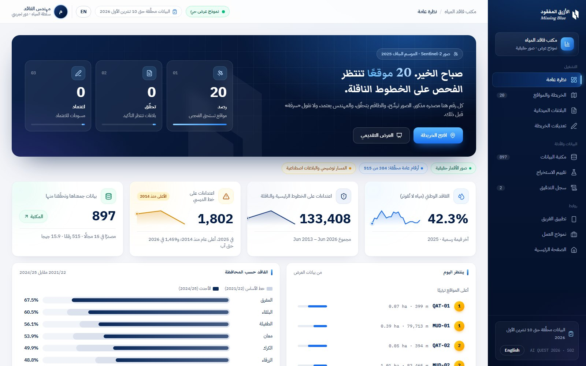
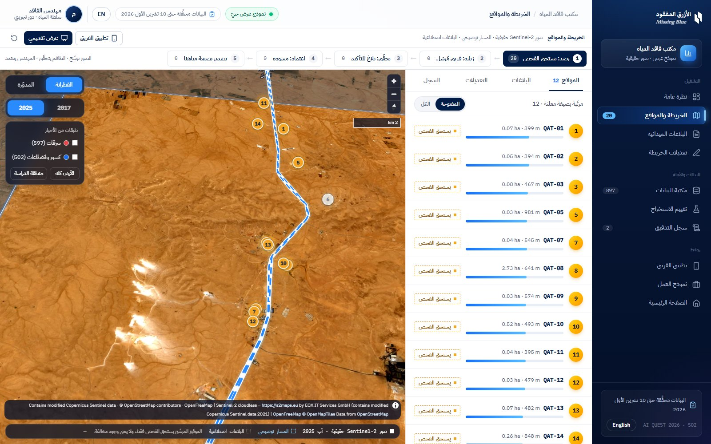
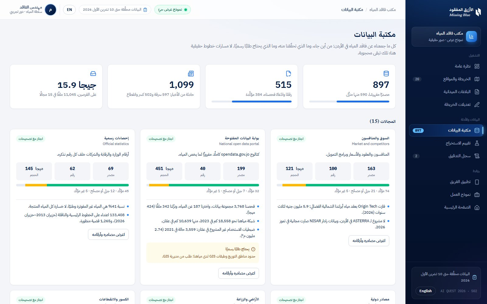
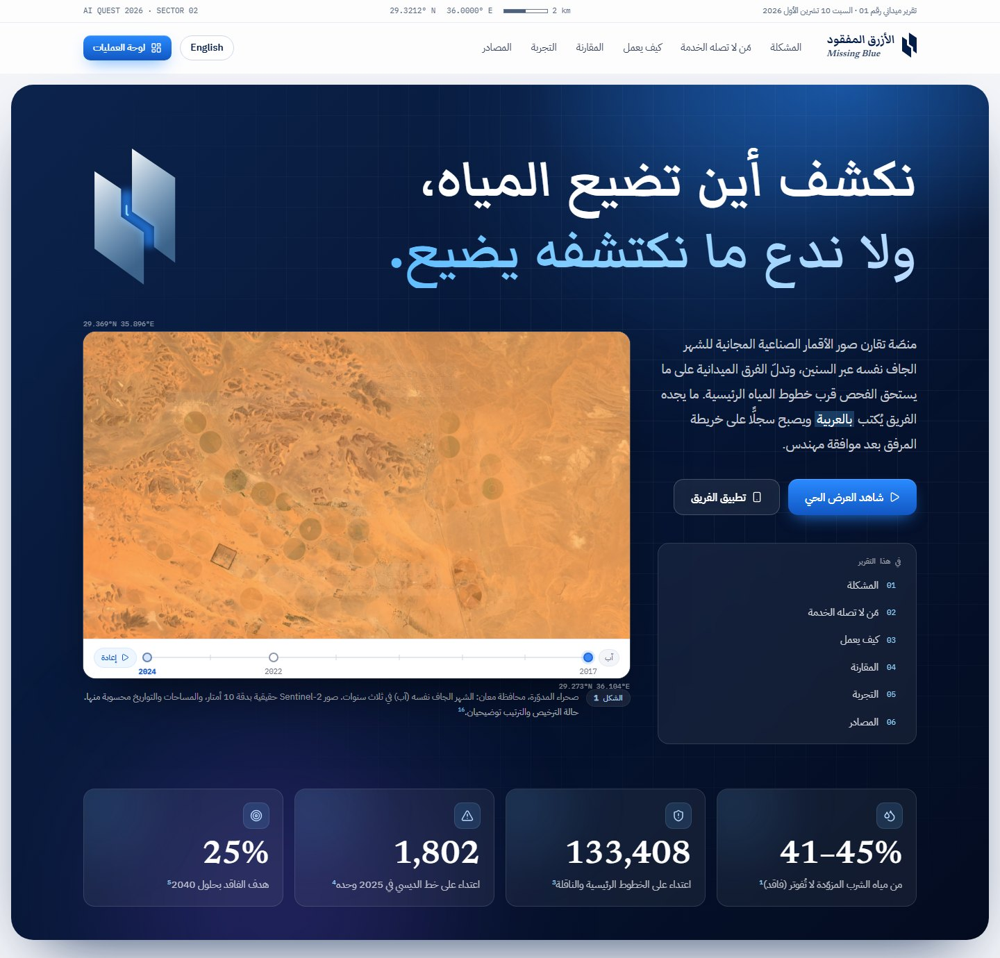
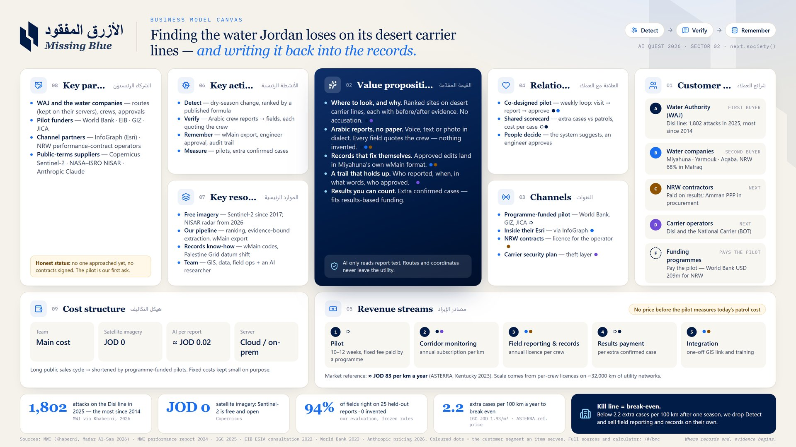

# الأزرق المفقود · Missing Blue

**Find where water goes missing along Jordan's desert carrier lines, verify it in the field in Arabic, and keep what crews find as map records the utility can trust.**

AI Quest 2026 · Al Hussein Technical University (HTU) · Sector 02 `next.society()`. Prototype built for the hackathon on 9–10 October 2026.

**[▶ Live demo](https://aboodhaymouni.github.io/missing-blue/)** · **[Operations dashboard](https://aboodhaymouni.github.io/missing-blue/#/app)** · **[Satellite map](https://aboodhaymouni.github.io/missing-blue/#/app/map)** · **[Business model](https://aboodhaymouni.github.io/missing-blue/#/bmc)** · **[Intro video (1:37)](https://aboodhaymouni.github.io/missing-blue/video/missing-blue-intro.mp4)**

[](https://aboodhaymouni.github.io/missing-blue/video/missing-blue-intro.mp4)

> نكشف أين تضيع المياه، ولا ندع ما نكتشفه يضيع.
> صور الأقمار الصناعية ترشّح مواقع تستحق الفحص قرب الخطوط الناقلة، والفرق الميدانية ترسل بلاغها بالعربية (صوتًا أو نصًا)، فيحوّله الذكاء الاصطناعي إلى حقول مع الكلمات التي استند إليها، ثم يصبح مسودة تعديل على الخريطة بصيغة مياهنا لا تُعتمد إلا بيد مهندس.

## Screenshots

| Operations dashboard | Satellite map and ranked sites |
|---|---|
| [](https://aboodhaymouni.github.io/missing-blue/#/app) | [](https://aboodhaymouni.github.io/missing-blue/#/app/map) |
| **Data library** | **Landing page** |
| [](https://aboodhaymouni.github.io/missing-blue/#/app/data) | [](https://aboodhaymouni.github.io/missing-blue/) |

[](https://aboodhaymouni.github.io/missing-blue/#/bmc/poster)

## Intro video

[`public/video/missing-blue-intro.mp4`](public/video/missing-blue-intro.mp4) (1:37, 1080p, English). The full-quality master is attached to the [v1.0 release](https://github.com/aboodhaymouni/missing-blue/releases/tag/v1.0).

It covers the problem, Detect · Verify · Remember, and the numbers behind them. It uses real Sentinel-2 imagery from this repository; the route is illustrative and the crew report is synthetic, as everywhere else. The narration is Gemini 3.8 Flash TTS (via OpenRouter), the score is Google Lyria 3, and the animation is code: the Remotion project is in [`video/`](video/).

```bash
npm run video:install
npm run video:render     # writes video/out/missing-blue.mp4
```

## What it does

1. **Detect.** Dry-season Sentinel-2 images (2017 → 2025) show new green patches in the desert. Patches near a carrier line, isolated from farmland, persistent across years and small are ranked first, using a published formula: `0.30 near-line + 0.25 isolation + 0.20 NDVI gain + 0.15 persistence (2024–26) + 0.10 small size`.
2. **Verify.** A crew visits and reports in Jordanian Arabic by voice, text or photo. The report becomes ten structured fields (outcome, asset, line, material, diameter, location, depth, count, flow, missing-from-map). Every filled field shows the exact words it came from; a field with no words behind it is left empty.
3. **Remember.** A confirmed unmapped connection becomes a draft edit in Miyahuna's `wMain` schema, drawn dashed until an engineer approves it, then exported as GeoJSON in the Palestine 1923 / Palestine Grid (EPSG:28191).

## What is real, what is simulated

| Real and working | Simulated and labelled | Not built yet |
|---|---|---|
| Sentinel-2 L2A imagery and per-site NDVI, 2017–2026 | The pipeline route: a Desert Highway centreline proxy, **not** the real line | Writing straight into Miyahuna's Esri database |
| Site ranking with the published formula | Crew reports in the demo (synthetic, marked everywhere) | Sign-in, roles and the four-eyes rule |
| Arabic extraction: rules in the browser, Claude when a key is set | The licensed-use list | NISAR radar for below-surface leaks |
| Export in `wMain` format to EPSG:28191 | | |

A candidate site is only worth a visit. It is never presented as a violation.

## Run it

Tested with Node.js 24.11 on Windows 11. Clone it, install it, and it runs: no key, database or extra download is needed.

```bash
git clone https://github.com/aboodhaymouni/missing-blue.git
cd missing-blue
npm install
npm run dev
```

Then open http://localhost:5180/. Or skip the install and use the published copy at https://aboodhaymouni.github.io/missing-blue/.

| Page | URL |
|---|---|
| Landing page | http://localhost:5180/ |
| Operations dashboard (overview) | http://localhost:5180/#/app |
| Satellite map, ranked sites, reports and edits | http://localhost:5180/#/app/map |
| Map in presentation mode (7 guided steps) | http://localhost:5180/#/app/map?demo=1 |
| Data library (sources, facts, news events) | http://localhost:5180/#/app/data |
| Extraction evaluation | http://localhost:5180/#/app/eval |
| Audit trail | http://localhost:5180/#/app/audit |
| Crew app (open it in a second window) | http://localhost:5180/#/crew |
| Business model canvas, value calculator (prints to one A4 landscape page) | http://localhost:5180/#/bmc |
| Business model as a one-page poster (16:9) | http://localhost:5180/#/bmc/poster |

The same pages are published as a static site at https://aboodhaymouni.github.io/missing-blue/ (rules engine only; see Build).

The console and the crew app share state through the browser (`localStorage` + `BroadcastChannel`), so run both in the same browser on the same machine. A phone on the same network can open the crew app (`npm run dev` listens on the LAN), but it keeps its own state.

The reset button in the console's top bar restores the demo data.

### Switch on Claude for the field reports

Without a key everything works and the rules engine extracts the fields. To use Claude, put the key in `.env.local` next to `package.json` (it is git-ignored and is never sent to the browser):

```
ANTHROPIC_API_KEY=your-key
```

Then restart `npm run dev` and check http://localhost:5180/api/health, which should answer `{"available":true,...}`. In the console, open a report and press **Re-extract with AI**; on the evaluation page, press **Run Claude** to score it on the 25 held-out reports (25 requests, roughly half a dollar at list prices).

| Variable | Default | Purpose |
|---|---|---|
| `ANTHROPIC_API_KEY` | – | Key used by the local server |
| `MB_MODEL` | `claude-opus-5-5` | Model for extraction |
| `MB_AI` | – | `off` turns the AI endpoint off |

How the AI call is guarded (`server/extract-core.ts`):

- Structured output with a fixed JSON schema: one `{value, quote}` per field.
- The prompt asks for the crew's words copied exactly, and for empty fields when the report is silent.
- The server drops every field whose quote is not in the report; the browser checks again. Dropped fields are listed as warnings, not hidden.
- Refusals and errors fall back to the rules result; the reason is shown in the console.
- At most 30 calls a minute and 2,000 characters per report, because the dev server is reachable on the LAN.

### Build

```bash
npm run build
npm run preview
```

`dist/` is a static site that works from any folder (XAMPP, GitHub Pages, a USB stick). The AI endpoint only exists while `npm run dev` or `npm run preview` is running; a static copy uses the rules engine.

### Checks

```bash
npm run typecheck
npm test
```

`npm test` runs the extraction server against a local mock of the Messages API: it checks the request we send, that invented quotes are dropped, the retry without the fallback beta, and that a refusal is an error, never an empty answer. It needs no key and no network.

## Evaluation

`/#/app/eval` scores both engines on 35 synthetic reports hand-labelled for all ten fields:

- **Development set (10):** the demo reports. The rules were written while looking at them, so their score is optimistic.
- **Held-out set (25):** written after the rules were frozen; no rule was changed after seeing the result, and the AI prompt contains none of these texts.

Rules engine on the held-out set, as computed by the page: visit outcome **19 / 25**, all fields **235 / 250 (94%)**, 3 fields filled that the report did not state, **0** fields shown without the crew's words, **0** reports shown as confirmed before an engineer. Its misses are what keyword rules cannot read: "ما في ولا تسريب", "بدون ترخيص", English words, and context such as dampness explained by rain. The Claude column is filled when the page is run with a key.

## Business model

`/#/bmc` holds the business model canvas, a break-even calculator, the path to revenue, the riskiest assumptions with their kill conditions, the hardest questions we expect, and a "why now" timeline. Every figure has a numbered source; estimates and assumptions are labelled.

- **Who pays:** the Water Authority (it answers for the carrier lines), the water companies' GIS and NRW directorates, NRW contractors on performance contracts, and carrier operators. At the National Water Carrier's ESIA consultation (2022, p. 345) a participant warned that people steal water from the Disi line; the recorded reply was that the BOT developer must run a security plan against theft. Programmes that already fund water-loss cuts (World Bank, EIB, GIZ, JICA) pay for the pilot. None of them has been approached yet; the pilot is the first ask.
- **How we charge:** a programme-funded pilot; corridor monitoring per kilometre (the unit the market prices in); a field-reporting and records licence per crew (which works in cities too); a results payment per extra confirmed case; one-off GIS integration.
- **Price:** set after the pilot measures what patrols and rework cost today. The calculator gives the break-even instead. Only *extra* cases count: ones from our list that the utility's register didn't already hold. At the market reference price (about JOD 82.7 per km a year, from one public ASTERRA statement of work), 1,930 m³ per case (a placeholder: the 2025 national average per recorded attack) and JOD 1.93 per m³ (what a cubic metre cost the government to supply in 2024, IGC), a corridor subscription pays for itself at about 2.2 extra cases per 100 km a year. At the top household tariff (JOD 0.525) it takes about 8.
- **Scale:** corridor detection alone is small (Disi and the National Carrier are about 765 km). Scale comes from field reporting and records across the utilities' ~32,000 km of network, and from the region.

The calculator's arithmetic lives in `src/lib/biz.ts` and is covered by `npm test`.

## Data and provenance

| Data | Source | Use |
|---|---|---|
| Sentinel-2 L2A, dry season (Aug) 2017–2026 | Copernicus via Earth Search (AWS), harmonised `(DN − 1000) / 10000` | Images, NDVI change, per-site NDVI by year |
| ESA WorldCover 2021 (CC BY 4.0) | esa-worldcover.org | Distance to farmland (isolation) |
| CHIRPS v3 rainfall, 2015–2025 | UCSB Climate Hazards Center | Choosing the dry-season window (months with near-zero rain), so new green means water, not rain |
| `wMain` fields and code lists | GIZ National Water Master Plan public ArcGIS service (schema only, no geometry) | Export format |
| Facts on the landing page | Ministry, Miyahuna, Petra, JO24 and others; each has a numbered footnote and link | Problem and reach sections |
| Sentinel-2 cloudless 2021 by EOX IT Services ([s2maps.eu](https://s2maps.eu), CC BY-NC-SA 4.0, contains modified Copernicus Sentinel data 2021) | EOX WMTS tiles | Satellite basemap on the map page (attribution shown on the map) |

Restricted geodata (real pipeline routes, wells, reservoirs, pumping stations) is not in this repository and is not shown. The route on the map is illustrative. Reports contain no names, phone numbers or plates.

The `scripts/` folder rebuilds the generated files from a local imagery cache (`D:/forcast/water/imagery`) and the team's data collection (`../FORCAST/water`); neither is part of this repository. Python 3 with `numpy`, `scipy`, `rasterio`, `pyogrio`, `pyproj`, `shapely` and `Pillow`:

| Script | Writes |
|---|---|
| `render_imagery.py` | `public/imagery/*` true-colour crops and change overlays |
| `detect_patches.py` | per-patch numbers for the landing figures |
| `build_sites.py` | `src/data/generated/sites.json`, `demo_route.json`, evidence crops |
| `build_stats.py` | `src/data/generated/stats.json` (counts for the data section) |

## Export format

`wMain` attributes as Miyahuna records them: `MATERIAL` (PE, HDPE, PVC, GP, SP, DIP, CAS, AC), `DIAMETER` (mm, from the `piPipeDiameter_2` domain; 2-inch PE is 63 mm outside diameter, 2-inch metal is DN50), `CIP_WP_TYPE = 6` (house connection), `OWNEDBY = -1` (private), `WP_COND = 4` (under check) while a draft and `3` once approved, `WP_STATUS = 1` on approval, `WP_MAT_TXT_S` keeps the crew's own words. Coordinates are converted to EPSG:28191 with an explicit 7-parameter datum shift (`towgs84=-275.7224,94.7824,340.8944,-8.001,-4.42,-11.821,1`); without it the result is about 80 m off.

## Project layout

```
src/landing/        landing page sections
src/app/            console (map, panels), evaluation page
src/crew/           crew app
src/lib/extract/    Arabic normalisation, rules engine, AI client, scoring
src/lib/store.tsx   demo state, audit trail, sync between windows
src/lib/export.ts   wMain GeoJSON in EPSG:28191
src/data/           facts and sources, sample and evaluation reports, generated data
server/             Claude extraction endpoint (Vite plugin) and its tests
scripts/            data preparation (Python)
video/              the intro video as code (Remotion), with its audio and render tools
docs/media/         README screenshots and the video poster
```

Built with Vite, React, TypeScript, Tailwind CSS, MapLibre GL (EOX Sentinel-2 cloudless imagery with OpenFreeMap labels), proj4 and the Anthropic TypeScript SDK.
